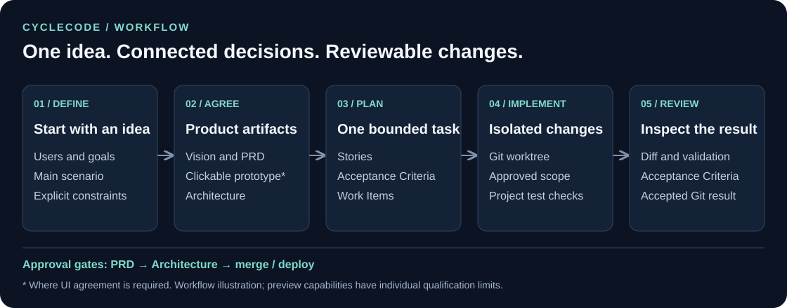

# CycleCode

**Turn an idea into a software project you can understand, check, and review.**

CycleCode is a local-first desktop workspace for developers and small teams building with AI agents. Define what to build, agree on the design, then review scoped code changes and their validation results in one project workspace.

This is the official release and feedback repository. Application source code is maintained privately.

**Current preview: 0.1.0-preview.6.** [Download CycleCode](https://github.com/cyclecode-labs/releases/releases) · [Release notes](release-notes/0.1.0-preview.6.md) · [First project walkthrough](GETTING-STARTED.md)

Experimental preview; the complete workflow is still being qualified. Check the release's attached application assets for platform availability. Windows builds may be unsigned; read the [installation notes](INSTALL.md) before running them.

## From Idea To Reviewed Change

*Workflow illustration, not an application screenshot or evidence of a completed run.*

For example, start with “a shared checklist for a small team.” Clarify the users and requirements, review a prototype and Architecture, then choose one Work Item with explicit acceptance criteria. Review its diff and recorded checks before accepting the result. The [walkthrough](GETTING-STARTED.md) explains the steps and where approval is needed.

## Why Use CycleCode?

- **Keep the reason for a change connected to the code.** Product artifacts, Stories, Acceptance Criteria and Work Items carry the context across specialized roles. Plan coverage makes gaps visible.
- **Review bounded changes.** Explicit approval gates and Git worktrees let you inspect the proposed scope and resulting diff before accepting a candidate.
- **Check results against the project.** Versioned Run Profiles define project commands; approved project test profiles become mandatory checks for newly prepared development and repair candidates. A manual Run/Test result is separate from Work Item acceptance evidence.

Start with an idea, or bring an existing repository for analysis and backlog preparation before authorizing scoped changes. Preview.6 also includes guided repair for eligible startup failures, per-project agent choices, and document authoring in role chats. See the [release notes](release-notes/0.1.0-preview.6.md) for boundaries and qualification limits. GitHub/Jira task intake reads remote tasks; it does not update remote issues.

## Get Started

1. [Install the application](INSTALL.md) from the official release assets. The desktop package includes its Java runtime. Install Git for repository operations and the build tools your project needs.
2. In the setup wizard, add and check an AI connection, then assign it to roles. You can start with one checked connection; advanced role settings and external MCP servers can wait.
3. From Home, choose **Create project**, enter a name and a short idea, then continue in Discovery. Aim first for a useful, saved product draft; implementation follows the applicable approval gates.

Follow the [first project walkthrough](GETTING-STARTED.md) for an example idea, the path to a checked Work Item, and help with common setup blockers. Provider accounts, CLI tools/authentication and project build tools depend on your choices. Model/API and other third-party charges are separate.

## Data, Updates And Terms

Project state and artifacts are stored locally. External AI providers can receive project context according to your configuration. [Data and backups](DATA-AND-PRIVACY.md) explains storage, backup contents and restore limits.

Updates are installed manually. [Upgrade instructions](INSTALL.md#updates) cover backups, update checks and the preview.5 → preview.6 Run Profile change.

The base edition is free for personal and commercial use under [LICENSE.txt](LICENSE.txt). Paid capabilities have separate terms; this README does not announce a paid feature list or promise future pricing. Read the [preview terms](PREVIEW-TERMS.txt) and [third-party notices](THIRD-PARTY-NOTICES.txt), with [license evidence](THIRD-PARTY-LICENSE-EVIDENCE.zip). Sharing official download links is welcome; republishing installers requires separate permission, subject to applicable law and third-party licenses.

## Feedback

[Report a bug or suggest an improvement](https://github.com/cyclecode-labs/releases/issues). Include your version, operating system, reproduction steps, and expected and actual behavior. Remove credentials and confidential project content from public screenshots and logs. License and redistribution questions can also be raised there.

Copyright © 2026 Rudenia Vitali. All rights reserved in proprietary components.
